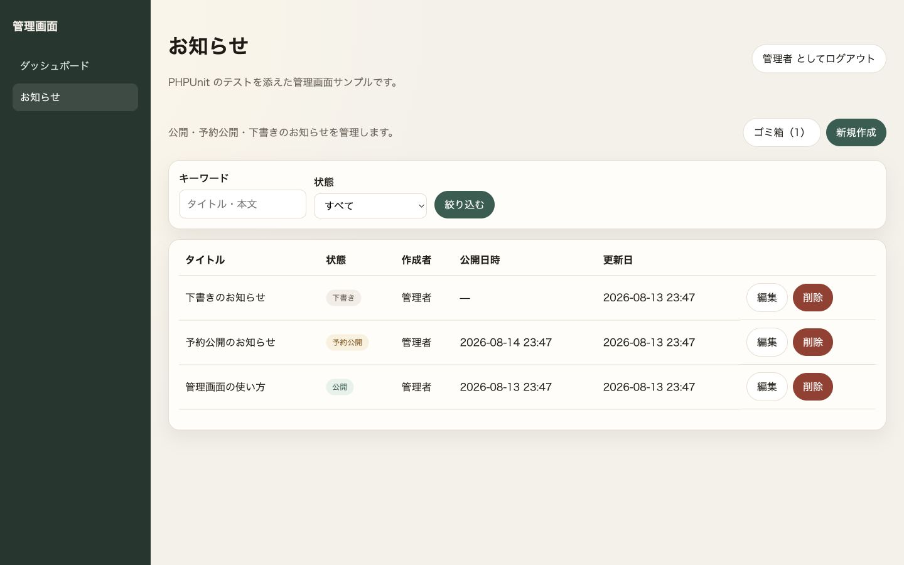
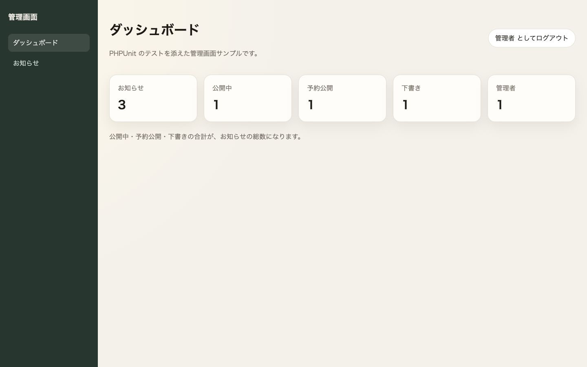
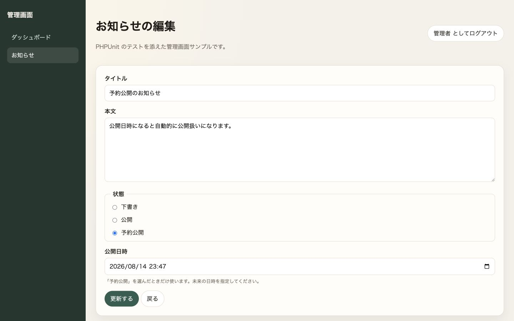
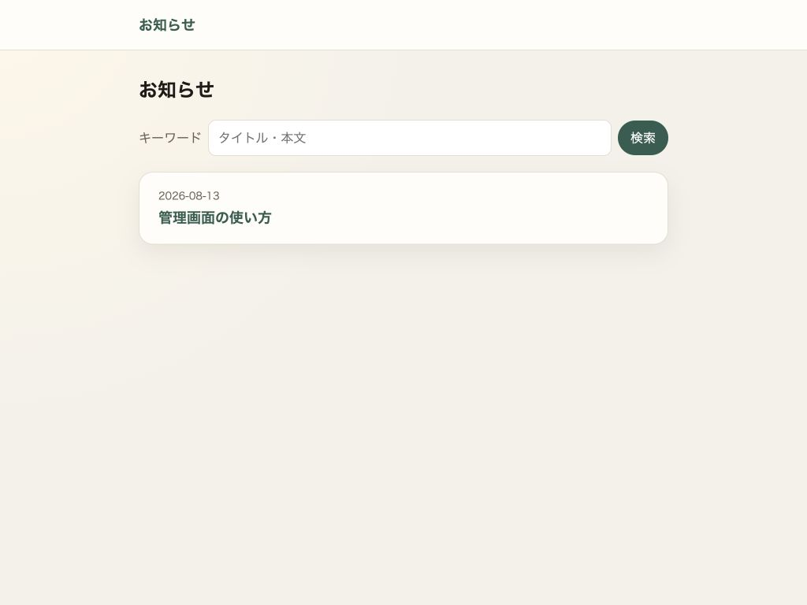

# Laravel 管理画面 × PHPUnit

[](https://github.com/kiyohara1021/laravel-admin-phpunit/actions/workflows/ci.yml)


[](https://github.com/kiyohara1021/laravel-admin-phpunit/releases)
[](LICENSE)

[日本語](README.md) | [English](README.en.md)

Laravel 13の管理画面を「作る」だけでなく、**認証・認可・検索・公開範囲の壊れやすい境界を、PHPUnitでどう固定するか**を示す学習・参照用サンプルです。



<p align="center">公開・予約公開・下書きを一画面で管理。検索、状態フィルタ、論理削除にも対応。</p>

## 普通のCRUDサンプルとの違い

- 公開側の検索に下書き・予約公開・削除済みを漏らさない
- Middleware、Policy、FormRequestの責務を混ぜない
- `published_at`だけで下書き・公開・予約公開を表現する
- `%`・`_`・`!`を含む検索語をSQLワイルドカードとして誤解釈しない
- ログイン試行をメールアドレスとIP単位で制限する
- FeatureテストとUnitテストの境界を実例で比較できる

詳細は[設計概要](docs/architecture.md)、[状態モデル](docs/domain-model.md)、[検索設計](docs/search-and-filtering.md)、[テスト戦略](docs/testing.md)にまとめています。

## 品質の証拠

| PHPUnit | 静的解析 | 対応PHP |
| --- | --- | --- |
| 185 tests / 674 assertions | Larastan level 10（テストコードも対象） | 8.4 / 8.5 |

テストは実行順をランダム化し、risky・警告・非推奨をすべて失敗として扱います。詳細は[テスト戦略](docs/testing.md)にまとめています。

CIではPHPUnit、カバレッジ計測、Pint、Larastan、Composer整合性、依存の脆弱性検査、Dependency Reviewを実行します。`main`はPull Requestと必須チェックで保護しています。

## クイックスタート

PHP `^8.4` とComposerが必要です。

```bash
composer install
cp .env.example .env
php artisan key:generate
touch database/database.sqlite
php artisan migrate --seed
php artisan serve
```

`http://localhost:8000`を開きます。

| ロール | メール | パスワード |
| --- | --- | --- |
| 管理者 | `admin@example.com` | `password` |
| 一般ユーザー（管理画面は403） | `user@example.com` | `password` |

これらはデモ専用のシード値です。本番では使用しないでください。

## 画面

<table>
  <tr>
    <td></td>
    <td></td>
  </tr>
  <tr>
    <td align="center">状態別件数を可視化するダッシュボード</td>
    <td align="center">下書き・即時公開・予約公開を切り替えるフォーム</td>
  </tr>
</table>



<p align="center">公開側には公開中のお知らせだけを表示。ログインやAPIキーは不要です。</p>

## 主なテスト対象

- 管理者ログイン、ログアウト、総当たり対策
- お知らせCRUD、予約公開、論理削除、復元、完全削除
- Middleware、Policy、Gateによる二層の認可
- 不正な状態フィルタ、ページャ、SQLワイルドカード
- 公開側への下書き・予約・削除済みレコードの漏洩防止
- HTMLエスケープ、作成者削除後のnull安全性

テストファイルごとの対応表は[テスト戦略](docs/testing.md)を参照してください。

## 品質チェック

```bash
composer check     # PHPUnit + Larastan + Pint
composer test      # PHPUnit
composer analyse   # Larastan level 10
composer lint      # Pint（検査のみ）
composer security  # 既知脆弱性の検査
```

## プロジェクト文書

- [設計概要](docs/architecture.md)
- [状態モデル](docs/domain-model.md)
- [検索とフィルタリング](docs/search-and-filtering.md)
- [テスト戦略](docs/testing.md)
- [変更履歴](CHANGELOG.md)
- [コントリビューションガイド](CONTRIBUTING.md#日本語)
- [セキュリティポリシー](SECURITY.md#日本語)
- [サポート方針](SUPPORT.md)

## 本番利用について

このリポジトリは学習・参照用です。本番化には、デモ認証情報の削除、パスワード再設定、監査ログ、バックアップ、監視、デプロイ先固有の設定などが必要です。

## ライセンス

[MIT License](LICENSE)。複製・改変・再配布・商用利用が可能です。Composerで導入される依存パッケージは、それぞれのライセンスに従います。
