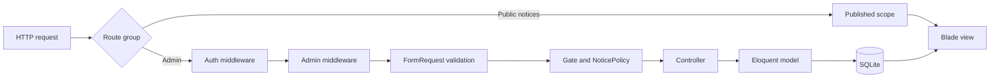

# 設計概要 / Architecture

このサンプルは、小さなLaravel管理画面でも「入力検証」「区画への入場」「資源ごとの認可」「公開範囲」を混ぜないことを主題にしています。

## リクエストの流れ

## 境界ごとの責務

| 境界 | 実装 | 責務 |
| --- | --- | --- |
| 認証 | `auth` middleware / `LoginController` | ログインしているか |
| 管理区画 | `EnsureUserIsAdmin` | 管理画面へ入れるか |
| 資源操作 | `NoticePolicy` / `Gate` | お知らせへ何をしてよいか |
| 入力 | `StoreNoticeRequest` / `UpdateNoticeRequest` | 値が操作の前提を満たすか |
| 公開範囲 | `Notice::published()` | 公開中のレコードだけか |
| 表示状態 | `NoticeFilter` | GETクエリを安全な絞り込みへ変換する |

管理者の定義は `User::isAdmin()` に集約し、ミドルウェアとPolicyが同じ判定を使います。公開詳細は暗黙のRoute Model Bindingではなく `published()->findOrFail()` で取得し、下書き・予約公開・削除済み・存在しないIDを同じ404として扱います。

## お知らせの状態

状態列を増やさず、`published_at` だけを正本にします。

| 条件 | 状態 |
| --- | --- |
| `published_at IS NULL` | 下書き |
| `published_at <= now()` | 公開 |
| `published_at > now()` | 予約公開 |

この定義は `NoticeStatus` とモデルスコープに集約されています。

## テスト戦略

- Featureテスト: ルート、ミドルウェア、認可、DB、BladeをHTTP経由でまとめて検証
- Unitテスト: 状態判定、クエリスコープ、Policy、値オブジェクト、レート制限キーを局所的に検証
- 静的解析: Larastan level 7でEloquent属性、コントローラ境界、設定値の型を検査
- コードスタイル: Pint
- 依存関係: `composer validate --strict`、Dependency Review、Dependabot（手元では `composer security`）

## 本番利用との境界

このリポジトリは学習用です。本番化には、デモ認証情報の削除、メール確認・パスワード再設定、監査ログ、CSRF/CSPを含む運用設計、バックアップ、監視、デプロイ先固有の設定が別途必要です。
